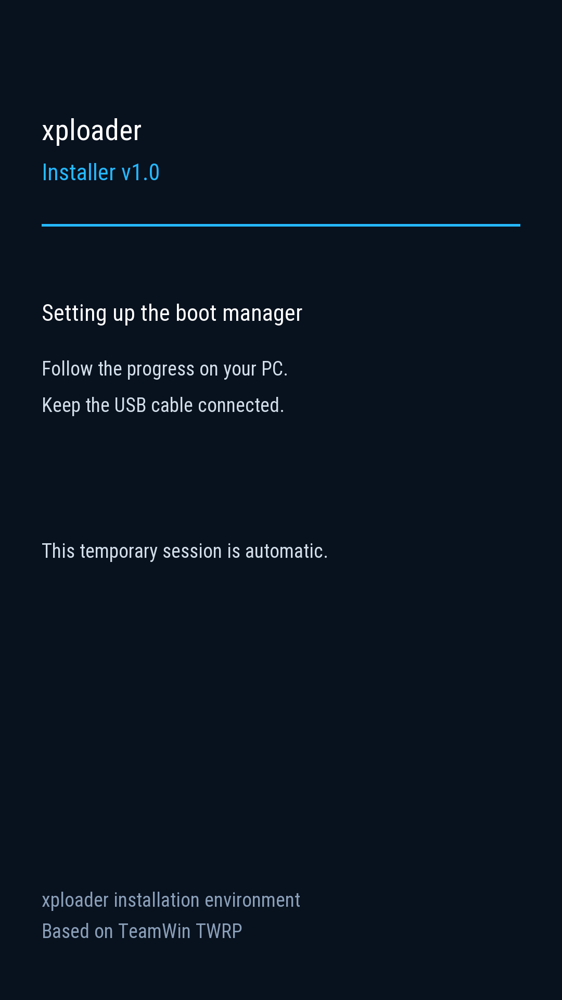

# Installing xploader v1.0

Use an **unlocked Sony Xperia Z5 E6653**, an exFAT MicroSD and a Windows PC.
Confirm the model from the phone's label; recovery model properties alone do
not establish the physical variant. Other Z5 variants remain unverified.

The Windows app has been tested on the E6653 from cold fastboot: stock-layout
migration, OS boot preservation, and source-bound SD recovery/GPT/boot readback
passed. A complete manual updater run also reached `SUCCESS`, restored Always
Menu and left SD TWRP with its screen off. Full matching Sony stock restoration
was separately verified. See [validation scope](VALIDATION.md) for the exact
first-install and updater test boundaries.

## Windows installer

1. Confirm **E6653**, an **already unlocked bootloader**, at least **30% battery**,
   and an inserted **exFAT MicroSD**. The tool does not unlock or format the phone/card.
2. Extract **`xploader-v1.0-windows.zip`** to a writable local folder.
3. Power off. Hold **Volume Up** while connecting USB; the indicator should
   turn blue. Ensure the Sony fastboot USB driver is installed.
4. Run **`xploader-v1.0.exe`** and type **`INSTALL`** at the opening prompt.
   Python installation is unnecessary. Keep USB connected and let the app finish.
5. The phone automatically starts a temporary **xploader Installer** screen,
   then installs the manager and reboots through it into SD TWRP for verification.
   **You do not need to install TWRP manually or operate its menus.** Wait for
   **`SUCCESS`** in the PC window before touching or restarting the phone.
6. Keep **`installer/work`** (the device-specific recovery record) and
   **`installer/logs`** (diagnostics). A successful run saves **Always Menu** and
   leaves the phone in original SD TWRP with its screen off. Choose **Reboot →
   System** there to return to the xploader menu.

Allow several minutes, including SD loading and the final screen-off wait.
The app prints elapsed waiting times. Initial component downloads also need
internet access. Google Platform Tools and the original sumire TWRP are
obtained directly from their publishers and checked against fixed size/hash
values. The temporary installation screen is built locally from that recovery;
it is not an additional recovery installation. The final original TWRP screen
is expected: it proves the new manager can load `/twrp.img` from SD.



*Actual phone framebuffer screenshot of the temporary installer interface.*

If the PC window says **`STOPPED`**, retain the displayed record/log path and
read the reported stage. Do not assume a stopped final check means no writes
occurred. An early temporary-boot failure explicitly reports that no partition
was flashed; a later interruption requires checking the saved transaction.

From original TWRP 3.7 with root ADB, this is a read-only phone check:

```text
xploader-v1.0.exe --check
```

It does not reboot or write phone partitions/SD files; missing host tools can
be downloaded. Source users with Python 3.10+ can run `Install-xploader.cmd`
after supplying the release assets. A GitHub source ZIP alone lacks those
binary assets. Use the Windows ZIP from the v1.0 release for the ready-to-run app.

The installer records exact before/after windows, checks both GPT copies,
retains the original Sony normal-boot GUID and refuses unknown layouts. Write
order is OS copy, backup GPT, primary GPT, then manager. It does not write S1,
TA/DRM, system, userdata or the SD partition table. A supported Sony ELF boot is
repackaged with the same kernel, initrd and DTBs; a supported Android boot image
is preserved. This preserves OS boot, not all personal data.

## Persistent layout

| Purpose | GPT name | Partition | Size |
| --- | --- | --- | --- |
| Sony normal-boot manager, original boot GUID retained | `xploader` | p29 | 32 MiB |
| Replaceable eMMC OS boot | `boot` | p44 | 32 MiB |

These extents occupy the original 64 MiB boot area; unrelated GPT entries are
preserved. Ordinary Linux/TWRP installers using `boot` update the OS partition.
**Never copy another phone's GPT.** An update to a supported split layout writes
only the manager and preserves the separate OS boot.

## Fastboot

Enter blue-light fastboot from power-off with **Volume Up + USB**. With Android
Platform Tools:

```text
fastboot devices
fastboot getvar product
```

An `Unknown` product response alone is not model verification. The installer
uses `fastboot boot` to start its temporary installation environment, with
explicit recovery mode for cold fastboot. That environment uses the original
TWRP kernel and userspace executables with an installer-only screen; it checks
the real device and layout before bounded migration/write operations.

For an advanced **stock-layout, SD-only trial**, a release's clean boot image
can replace the original boot payload:

```text
fastboot flash boot xploader.img
fastboot reboot
```

This short route does **not** create the persistent split layout or preserve
the original eMMC OS boot. Boot eMMC needs the split layout, and a later ROM
flash can overwrite a stock-layout manager. Use the installer for a persistent
installation. On an already split phone, do not assume fastboot's `boot` name
selects the manager. Never flash a native-core `.bin`.

## SD and menu

Put original sumire recovery at **`/twrp.img`** and an adapted OS folder such as
**`/lineageos19`** at the SD root. Choose it under
`Service → Boot Settings → AD SD Dir`, then **Boot SD**. QuickBoot targets eMMC,
the selected SD folder or TWRP; **Always Menu** restores the startup menu. Hold
Power during startup to override QuickBoot, releasing it when the menu appears.
Volume moves; short-press/release Power selects.

`Service → PC SD Access` provides a bounded 180-second native USB mass-storage
session. Eject/safely remove the PC disk and wait for the session to finish
before booting an OS. Use recovery MTP/ADB or a card reader for longer transfers.

## TWRP and missing SD cards

**Do I need to prepare `twrp.img` myself?** The Windows app downloads and
verifies the original image and places it at `/twrp.img` automatically. If a
different image already exists there, the app backs it up for verification and
restores it afterward. Keep that recovery compatible with the loader/device.

**Installing without a card:** the app requires mounted exFAT storage and stops
before any partition write if it is unavailable. The temporary RAM installation
environment may already have started. No card formatting is performed.

**Removing the card after installation:** the manager and eMMC OS boot remain
in eMMC. The code defaults to Always Menu when it cannot load the SD settings;
Boot eMMC can still load a valid installed OS. SD systems, SD recovery and
saving settings require the card. Selecting an unavailable SD payload reports
an error and returns to the menu. This no-card fallback follows the current
code; a separate physical no-card cold-boot acceptance has not been recorded.

## Remove xploader / return to Sony stock firmware

Use **Flashtool in green-light flashmode** with a complete matching E6653 FTF
covering the original partition layout, kernel, system and required firmware
components. From power-off, hold **Volume Down** while connecting USB. Flashmode
and blue-light fastboot use different Windows drivers.

The restoration test used Flashtool **0.9.36.0** and
**E6653_32.4.A.1.54_Customized_UK.ftf**. Its 32GB partition template matches the
phone's original layout, including the 64 MiB boot area. After the full flash,
both GPT copies and all 43 original entries matched that template. With USB
disconnected, a power-only startup entered Sony Android **7.1.1 / 32.4.A.1.54**
directly, without xploader; stock UI and ADB were verified. A boot-only flash
does not restore the partition layout.

The test phone has a pre-existing `Unknown` TA model string. The ordinary GUI
rejected that identity. The successful test used the unmodified official
Flashtool engine through a private, device-bound API wrapper with a temporary
model alias. The alias did not alter the FTF/SIN bytes, signature checks,
hardware matching or TA model string. This validates full restoration on this
phone; it does not validate a generic GUI workaround for every device reporting
`Unknown`.

Stock restoration can clear internal user data. Keep SD payloads and do not
select SD formatting. Returning stock does not relock the bootloader or recover
lost DRM/TA keys. No relock or DRM operation is part of xploader installation.

A hung payload without USB can still need physical reset. Keep the local
installer record; unknown or partially written states are refused rather than
silently treated as a completed installation.
